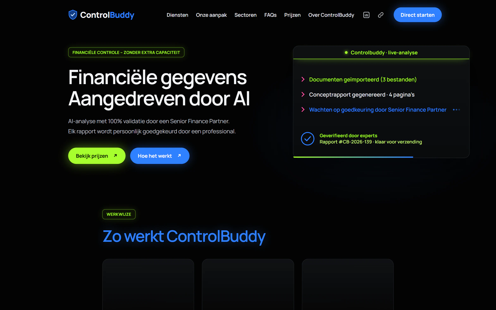

# ControlBuddy

**A Lexvaxa partnership: an AI-powered financial control service for Dutch businesses, where a Senior Finance Partner signs off every AI report.**

     

## Overview

ControlBuddy is a Dutch financial control service built in partnership with Lexvaxa. Businesses upload their financial data through a short request form, an AI engine structures it and drafts a concept report within minutes, and a Senior Finance Partner reviews and approves every report before it is delivered. Lexvaxa designed and built the platform: the Dutch-language website, fixed-price service packages, delivery speed options and a service request form that calculates the price as the client fills it in.

## The challenge

Small and mid-sized companies need internal control and financial insight but rarely have the in-house capacity, and traditional controllers are slow and expensive to bring in.

## The solution

An AI-first workflow with a human sign-off: secure data upload, automated analysis and drafting, and partner validation, sold as clear fixed-price packages with optional faster delivery.

## Key features

- Secure data upload through a short service request form
- AI analysis that drafts a concept report in minutes
- Every report personally approved by a Senior Finance Partner
- Fixed-price packages from quick scans to internal control testing
- Delivery speed options from 48 to 72 hours down to 4 hours
- Live price calculation as clients choose services and delivery speed
- Sector pages for healthcare, tech, construction and logistics
- Dutch-language site with FAQ and compliance information

## Results

- Built and run in partnership with Lexvaxa
- Intake, AI analysis and partner approval combined in one workflow

## Tech stack

Framer · AI document analysis · Workflow automation · Dynamic pricing form

## Screens

## Privacy

Client names and records are confidential. Every screen in this repository uses sample data, and source code that belongs to the client is not published.

## Links

- Case study on Lexvaxa: https://lexvaxa.com/work/controlbuddy
- Built by **Ch Muhammad Samiullah** ([GitHub](https://github.com/samiullah156-creator)) at [Lexvaxa](https://lexvaxa.com)
